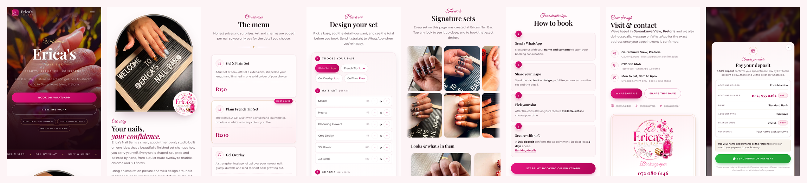
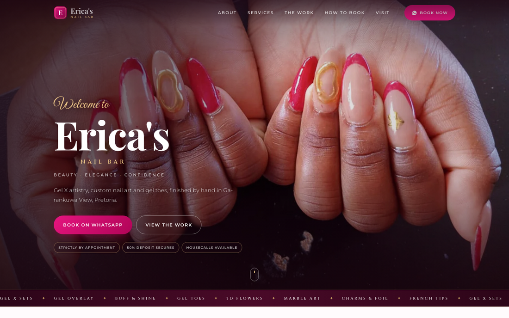

# Erica's Nail Bar website

**Live site: <https://marshall-007.github.io/Erica-s-Nail-Bar/>**

A fast, mobile-first single-page site for Erica's Nail Bar
(Ga-rankuwa View, Pretoria · WhatsApp 072 080 6146 · @ericas.nailbar).

Plain HTML, CSS and JavaScript. No build step, no framework, no dependencies.
Drop the folder on any host and it works.





---

## Run it locally

```bash
python3 tools/serve.py 4321
```

Then open <http://localhost:4321>.

## Put it online

Any static host works. Upload everything **except** `source-images/` and `tools/`.
(Those are the originals and the build scripts. Keep them, just don't publish them.)

- **Netlify / Vercel / Cloudflare Pages**: drag the folder onto the dashboard.
- **GitHub Pages**: push the folder, enable Pages on the branch.
- **Normal cPanel hosting**: upload to `public_html`.

Serve it over **https** so the "Add to Home Screen" app behaviour works.

---

## The pages, in order

| Section | What it does |
| --- | --- |
| Hero | Logo lockup, tagline, WhatsApp button |
| Ticker | Scrolling list of services |
| About | Studio story + the three things clients ask about |
| Services | The four Gel X services, Buff & Shine, and the art/charm price lists |
| Design your set | Live price calculator that sends the chosen set to WhatsApp |
| The Work | Auto-scrolling photo band plus swipeable "signature sets" with a lightbox |
| How to Book | The four booking steps |
| Booking Policy | The house rules |
| Visit & Contact | Area, phone, socials, share button |

Mobile also gets a fixed **Call / Book / Gallery** bar, and the site can be
added to a phone's home screen like an app (`manifest.webmanifest` + `sw.js`).

---

## Editing the things that change most

**Prices.** They appear in three places. Keep them in step:

1. `index.html` → the `.svc-price` blocks and the two `.price-list` lists.
2. `index.html` → the `data-price` attributes in the *Design your set* section
   (and the `value` on the four base-service radios).
3. `index.html` → the `hasOfferCatalog` block in the `<script type="application/ld+json">`
   at the top (this is what Google reads).

**Phone number.** Search `27720806146` (WhatsApp links, `tel:` links, JSON-LD)
and `072 080 6146` (the visible text).

**Opening hours.** Shown in the Visit section and under the booking button, and
set in the `openingHoursSpecification` block of the JSON-LD.

**Online booking.** `CAL_LINK` at the top of `js/main.js` holds the Cal.com
link (currently <https://cal.com/enb24>). Everything marked `data-cal` reads
from it: the pink **Book** button in the mobile bar, the "Pick a time online"
button under the booking steps, and the one in the mobile menu.

Empty the string and the two optional buttons disappear, while the mobile bar
button falls back to the WhatsApp link in its `data-cal-fallback` attribute,
so that slot is never left without a destination.

**Gallery.** Each look is one `<article class="reel-card">` in `index.html`.
The card's `data-file`, `data-name`, `data-tags` and `data-from` attributes also
drive the scrolling band and the lightbox, so the HTML is the only place to edit.
Cards are numbered by their order on the page, so you can add or reorder them
freely.

`data-alt-files` is optional: a `|` separated list of extra photos of the same
set. They appear in the scrolling band and open in the lightbox under that
set's name and price, which keeps several angles of one manicure out of the
card list where they would just read as repeats.

### Adding a new set to the gallery

1. Put the original photo in `source-images/` as `nails-<name>.jpeg`.
2. Add a `render` line for it in `tools/build-images.sh`, choosing a 4:5 crop
   that puts the nails, not the palm, in the middle of the frame.
3. Run `bash tools/build-images.sh`.
4. Copy an existing `.reel-card` block in `index.html`, update the file name,
   title, description, tags and price.

---

## Tooling

| File | Purpose |
| --- | --- |
| `tools/build-images.sh` | Rebuilds every web image from `source-images/` (needs ImageMagick + cwebp) |
| `tools/serve.py` | Local preview server |
| `tools/shots.sh` | Headless-Chrome screenshots for checking layout |

Social handles: Instagram and Facebook are `ericas.nailbar`; TikTok is
`@ericamlambo`.

Adding `?noanim=1` to the URL renders the page with no animation, which is handy
for screenshots and for checking layout.

## Housekeeping

- After changing any file, bump `CACHE` in `sw.js` (`enb-v5` -> `enb-v6`, and
  so on) and the `?v=` number on the CSS and JS links in `index.html`. HTML,
  CSS and JS are fetched network-first, so a deploy reaches visitors on their
  next load; images and fonts stay cache-first for speed.
- Fonts are self-hosted in `assets/fonts/` (Playfair Display, Cinzel, Great Vibes
  and Montserrat, all SIL Open Font License), so the site loads fast and works offline.
- Photography and the logo belong to Erica's Nail Bar. Originals are kept in
  `source-images/`; everything in `assets/img/` is generated from them.
- House style: no em dashes anywhere in the copy.
